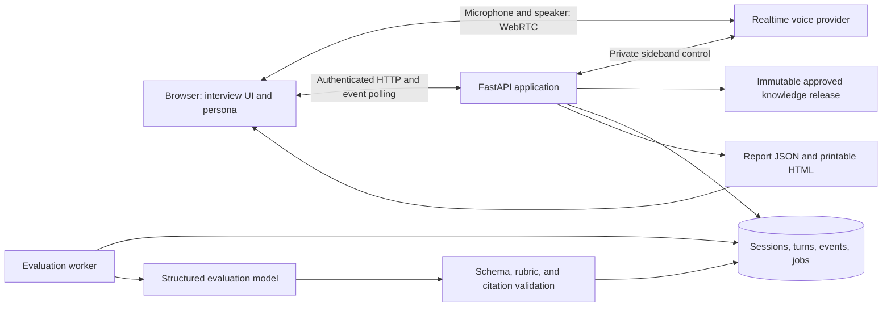
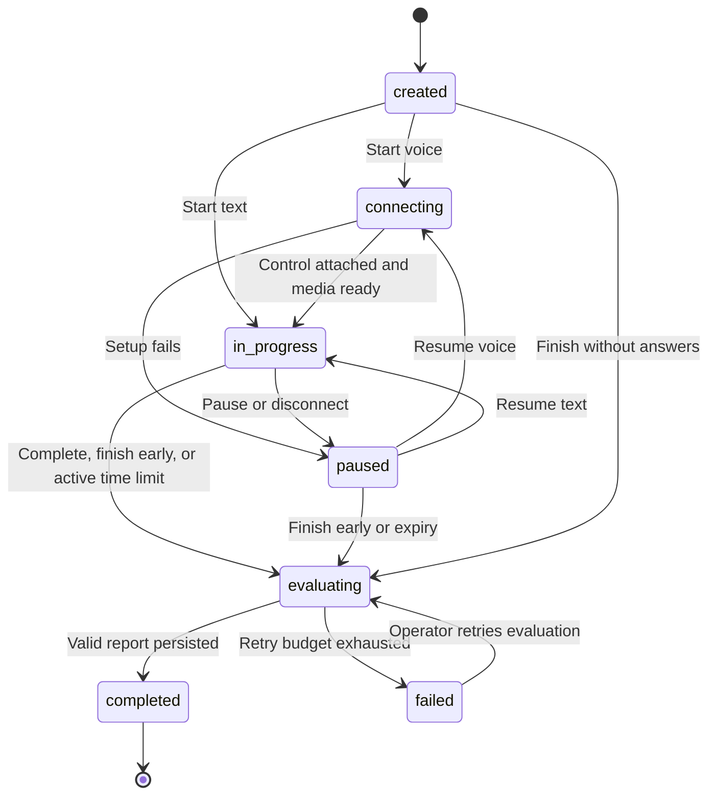

# Technical Viva — Implementation Specification and Roadmap

Status: implementation specification with application source and v2 contracts added; dependency-backed integration and production release gates remain unverified. Owner: Person C, with shared infrastructure from Person B and approved knowledge from Person A. This specification replaces the scripted-only Viva design. It covers a 36-hour demo followed by a production release.

## 1. Product outcome and agreed requirements

A learner completes an Apprentice Playground attempt, meets an animated digital interviewer, answers technical questions by voice or text, and receives an evaluation grounded in the same approved knowledge release. The interviewer responds conversationally and asks bounded follow-ups. The final report combines interview performance, Playground outcomes, supporting citations, and an index of every document in that release.

| Decision | Required behavior |
| --- | --- |
| Delivery | Working hackathon demo first; production hardening follows |
| Persona | Simple animated avatar with a synthetic voice and visible AI identification |
| Conversation | Live one-on-one voice interview with text fallback |
| Interview style | Examiner mode: acknowledgments and clarification during the interview; corrections and grades in the report |
| Knowledge | Exact approved release used by the completed Playground attempt |
| Report | Performance analysis, evidence excerpts, citations, transcript, and complete release document index |
| Initial limits | English; one learner per session; three core questions; one follow-up per core question; ten active minutes |
| Assessment | AI-assisted reasoning assessment with reviewed rubrics; practical certification requires supervised assessment |

The demo asks the learner to explain their chosen check, respond to a changed condition, and recognize insufficient evidence. Core objectives and base prompts are instructor-reviewed; follow-up wording is generated from the learner's answer and approved evidence. The AI does not invent engineering tolerances or treat unsupported knowledge as established fact.

### Learner flow

1. Complete a Playground attempt and select **Start technical Viva**.
2. See the task, source release, interview limits, AI disclosure, and transcript storage notice.
3. Select voice or text. Voice mode asks for microphone permission and runs an input/output check before starting.
4. Meet the persona, hear the first question, and answer naturally. Captions show the current question and speech transcription.
5. Receive a neutral acknowledgment or a clarifying follow-up. Progress shows core questions completed, without a live score.
6. Repeat a question, mute the microphone, interrupt speech, pause, switch input mode, or finish early.
7. On completion, see evaluation status and then the report. Open evidence in its original release context and print the report.

Three completed core answers and their required follow-up decisions trigger evaluation automatically. A learner can finish early; unanswered objectives are then marked not assessed. A ten-minute active-time limit also freezes an incomplete interview. Paused time does not consume the limit; sessions expire after 24 hours and are evaluated as incomplete if any answer was committed.

## 2. System architecture

Use a modular monolith with one FastAPI application, one relational database, a web frontend, and one background worker in the demo. Studio publishes reviewed knowledge, Playground records deterministic training decisions, and Viva consumes both through internal service interfaces. Model output in Studio and Viva is variable; server state transitions, authorization, and bookkeeping remain explicit and testable.

The browser carries microphone and speaker audio directly through WebRTC. FastAPI negotiates the connection with a server-held provider key and attaches a sideband connection before enabling interview audio. The backend executes tools, observes completed conversation turns, enforces question limits, and persists progress. Only the backend advances interview state.

OpenAI documents the browser media path in [WebRTC](https://developers.openai.com/api/docs/guides/voice-webrtc) and private control connections in [Server-side controls](https://developers.openai.com/api/docs/guides/voice-server-controls). These establish integration capabilities; they do not guarantee application latency, account access, or transcript accuracy.

### Component responsibilities

| Component | Responsibility |
| --- | --- |
| Interview frontend | Setup, microphone controls, captions, current question, progress, avatar, text answers, report |
| Session controller | Ownership, release binding, state transitions, active-time accounting, single active connection |
| Interview orchestrator | Reviewed question order, contextual follow-up decisions, neutral responses, completion |
| Voice adapter | WebRTC negotiation, sideband events, cancellation, disconnect, provider event normalization |
| Knowledge adapter | Release-scoped context, document manifest, evidence lookup, context-size validation |
| Transcript service | Ordered committed turns, interruptions, provider deduplication, reliable resume |
| Evaluation worker | Frozen-input assessment, structured output validation, retries, report publication |
| Evidence resolver | Authorized documents, source excerpts, attributed expert responses, timestamped video |

The voice and text interfaces share the session controller and question policy. In text mode the orchestrator uses the Responses API and streams no audio; completed responses enter the same transcript format. Provider-specific event names stay inside adapters so SDK changes do not change the application event contract.

## 3. Technology stack and deployment

| Layer | Hackathon choice | Production evolution |
| --- | --- | --- |
| Web application | Next.js, React, TypeScript, Tailwind CSS | Same UI with authenticated learner/reviewer areas |
| Persona | Code-authored SVG/CSS states; browser Web Audio amplitude drives mouth movement | Improved animation and reduced-motion support |
| Live speech | OpenAI Realtime, browser WebRTC, backend sideband | Same integration with concurrency quotas and reconnect metrics |
| Text orchestration and evaluation | OpenAI Responses API, structured output, server-side validation | Model regression gates and reviewer workflows |
| Backend | FastAPI, Pydantic, SQLAlchemy, Alembic | Modular monolith remains the default |
| Database | SQLite in WAL mode on a persistent single host | PostgreSQL |
| Files | Persistent local directory shared with Studio | S3-compatible object storage |
| Jobs | Database-backed lease queue, one worker process | Celery with Redis, database as source of truth |
| Retrieval | Entire approved task pack within a configured context budget | PostgreSQL full-text search plus pgvector |
| Report | React HTML view with print stylesheet | Stored PDF generated by a Playwright worker |
| Tests | pytest for backend; Playwright for browser flows | Add load and model-regression suites |
| Deployment | Docker Compose: web, API, worker, HTTPS reverse proxy, shared persistent volume | Managed PostgreSQL, object storage, separately scaled API and worker |

Use Python 3.12 and Node.js 22 LTS as initial runtime baselines. Resolve framework/SDK versions with a compatibility spike and commit lockfiles before feature development. Configure exact provider model identifiers through `VIVA_VOICE_MODEL` and `VIVA_TEXT_MODEL`; record the resolved configuration version on every session. The initial spike must demonstrate account access, audio, transcript events, a private tool call, and structured evaluation before versions are frozen. Do not invent a model version or pricing quote from memory.

Required configuration: provider API key, model identifiers, database URL, media directory, allowed frontend origin, session signing/token configuration, maximum active seconds, maximum context tokens, provider timeout, evaluation retry limit, and per-session spend cap. Use server environment/secrets for keys. Browser configuration contains only public API locations and display settings.

Host the API on a process capable of maintaining long-lived outbound WebSockets. The demo uses one API instance so one process owns each sideband; production uses a connection-owner lease and routes commands to that owner. Serve the browser over HTTPS for microphone access. The database and media volume must survive container restarts. Readiness checks cover database access, queue access, required configuration, and available disk space; provider connectivity has a separate diagnostic check.

## 4. Persona and interview interface

The avatar has `idle`, `listening`, `thinking`, `speaking`, `paused`, and `error` visual states. Speaking animation follows actual audio playback, not just model generation. A simple mouth shape and amplitude-based movement are sufficient; exact phoneme synchronization and realistic video avatars are outside the demo.

Display captions, connection status, mute state, core-question progress, and time remaining. Provide keyboard-accessible controls, visible focus, text equivalents, and reduced-motion support. Text mode must be a complete interview flow. No learner camera or facial analysis is required.

When the learner interrupts, stop local playback, cancel outstanding generation, and notify the provider of the heard audio position where supported. Mark the interviewer turn interrupted. Repeat the question if its delivery was incomplete before accepting an answer. Never infer that the learner heard a question from generation completion alone.

## 5. Session state and conversation policy

### State transitions

A session is unique per source attempt and learner. Starting again returns the existing session, including a completed result. A fresh Playground attempt is the retry mechanism. Validate attempt completion, ownership, bundle/release consistency, reviewed question plan, rubric, source manifest, and context budget before creating a session.

Each mutation checks deduplication before revision checks, as in the shared API rules. Serialize learner-turn acceptance and progression per session. Increment the revision once per committed state change; event sequence numbers order durable events independently of revisions.

### Question policy

Keep three reviewed core questions in fixed objective order. Bind the question plan to the scenario version and terminal outcome. An AI follow-up is allowed only to clarify a missing explanation or test the same objective against approved evidence. It cannot introduce a fourth objective or another release.

The model proposes one of `acknowledge`, `ask_follow_up`, or `advance` through a validated server tool. The server enforces at most one follow-up per core question, three overall, and six question prompts overall. Repeats reuse the same question ID and do not consume another follow-up. The orchestrator cannot set scores or release grades.

During examiner mode, instruct the persona to avoid correctness judgments, answer keys, model answers, and coaching. A learner may ask for clarification of wording but not a worked solution. Test this policy with adversarial requests; a language-model instruction alone is not a mathematical guarantee against leakage. Keep private rubric descriptors out of the voice context.

Use server-controlled response creation after completed learner input. This prevents the provider from independently advancing questions. Tool authority is limited to reading scoped evidence and proposing interview actions. Retrieved material and learner answers are untrusted content, never tool instructions.

### Input, timing, and reconnect behavior

Voice transcripts arrive asynchronously and may differ from what the learner intended. Store final provider transcription, question association, provider item ID, and completion time. Empty or failed transcription requests repetition and creates no scored answer. Learners can flag an unclear turn during the interview; retain the original and append a linked replacement answer. Freeze replacements when evaluation starts.

Use a ten-second no-speech reminder; do not penalize silence. Active time is accumulated server-side from persisted activity intervals. Before enforcing the time limit, allow an already accepted utterance up to ten seconds to finish; unfinished speech is labeled interrupted and is not silently treated as a complete answer.

On disconnect, close the connection lease, enter paused, and preserve committed turns. A reload reads the session and events. A voice resume negotiates a new provider connection and rebuilds context from the stored question plan and transcript. Do not depend on provider conversation history surviving. Limit reconnect attempts to three with delays of one, two, and four seconds, then show explicit retry and text mode.

Only one input mode is active at a time. Switching modes pauses the session, invalidates the old connection epoch, and resumes with the selected mode. Reject late voice events from the old epoch and reject typed answers during active voice input. A second browser tab cannot take over an active connection without pausing it first.

## 6. Knowledge base and provenance

Studio owns approved knowledge, evidence, and original files. A release is immutable. Viva reads the exact release bound to the completed Playground attempt; later publications cannot change an existing interview or report.

### Release manifest addition

Add `documents` to the approved release contract. Each document entry contains stable `id`, title, version, checksum, media type, an authorized resolver path, evidence IDs, and availability. Evidence records retain original attribution and page/section or video timestamp locators. A generated knowledge unit is not automatically an original document.

For the demo, seed the manifest from the reviewed source clip, approved attributed expert responses, and any instructor-provided source documents. Represent an approved expert response as a versioned attributed source artifact when it needs a document-index entry. Studio publication validates the manifest and evidence relationships transactionally. An empty document list is explicit; never fabricate a document to fill the report.

Provide release-scoped resolution endpoints so every citation proves membership in the bound snapshot. Authorize before returning bytes or a short-lived object-storage link. A source URL must not contain a durable session token. Existing media range support remains available for timestamped playback.

### Context and retrieval

Demo: serialize the complete approved task pack within a configurable maximum of 12,000 input tokens, also bounded by the selected model's verified context capacity. Reserve room for instructions, transcript, and output. Reject oversize packs during session preflight with `knowledge_pack_too_large`; do not truncate silently.

Production: parse supported PDF, DOCX, text, and timestamped transcript sources; retain original checksums and locators. Start with 600-token chunks and 100-token overlap without combining documents. Index only approved release members. Apply tenant/task/release authorization filters before lexical and vector ranking, merge ranks, and retrieve at most eight passages under the context budget. Tune chunk sizes and retrieval on reviewed questions before general rollout.

The complete document index always comes from the release manifest, independently of retrieval. Mark each entry `cited`, `available_unused`, or `unavailable`. A source listed in the index is not necessarily covered by the interview. If required evidence is missing, mark that assessment not assessed rather than using general model knowledge as a substitute.

## 7. Data model and persistence

All IDs are opaque server identifiers. Store UTC timestamps, actor identity, revision, and immutable provenance. The following records are additions to the existing tasks, releases, bundles, attempts, and idempotency tables.

| Record | Required content and constraints |
| --- | --- |
| `viva_sessions` | Learner, unique attempt, release/bundle/hash, question-plan/rubric/prompt/model versions, state, mode, revision, active time, expiry, current question, connection epoch |
| `viva_question_coverage` | Core objective, stable question ID, delivered state, accepted answer IDs, optional follow-up ID, completion status |
| `viva_turns` | Ordered speaker/text, question ID, input mode, delivery status, provider/client item ID, replacement link, transcript-quality flag |
| `viva_events` | Session sequence, event type, minimal typed payload, timestamp; unique session/sequence |
| `viva_provider_receipts` | Unique connection epoch/provider event ID and normalized semantic key for events lacking IDs |
| `viva_connections` | Provider call ID, owner lease, epoch, lifecycle, expiry; at most one active connection per session |
| `viva_evaluation_jobs` | Unique session and transcript snapshot hash, status, attempts, lease, sanitized error, retry timing |
| `viva_reports` | Immutable report version, frozen input hash, validated content, configuration versions, timestamps |
| `release_documents` | Release membership and document metadata; unique release/document/version |

Store completed turns and question transitions in one transaction with their durable events. Polling never creates state. For voice events, deduplicate both transport receipts and semantic turn identity so replayed finalization events do not insert duplicate answers. Do not keep a database write transaction open during a provider request.

On finish, close answer acceptance, drain an already accepted utterance within its deadline, snapshot transcript/coverage/manifest/Playground result, and create one evaluation job transactionally. A unique session/snapshot constraint prevents duplicate jobs. Repeated finish requests return that job before revision checks, even with a new idempotency key.

## 8. Proposed API and event contracts

The generator and JSON contracts now describe v2 of the Viva interface. The backend also exposes typed runtime documentation at `/docs` and `/openapi.json`. The checked-in contracts use OpenAPI 3.0.3 version 2.0.0; runtime FastAPI documentation uses its supported OpenAPI version. Studio authoring and Playground execution remain adjacent component contracts, while Viva and scoped release/source resolution have application implementations.

All paths below have `/api/v1` prefix. Derive learner identity from the authenticated demo bearer session. Mutations require `Idempotency-Key`; body revision fields are required where shown. Never accept scores, arbitrary release bindings, provider tool credentials, or next-state values from the browser.

| Method and path | Input | Success behavior |
| --- | --- | --- |
| `POST /viva/sessions` | `attempt_id`, `input_mode` | 200 existing or newly created bound session |
| `GET /viva/sessions/{id}` | Session ID | 200 current session and current delivered question; no private rubric |
| `POST /viva/sessions/{id}/connection` | `expected_revision`, `sdp_offer`, affirmative `microphone_consent` | 200 SDP answer, connection ID, updated session; sideband attached before microphone enablement |
| `POST /viva/sessions/{id}/connection/ready` | `expected_revision`, `connection_id` after browser media connects | 200 active session; first spoken question and microphone activation wait for this acknowledgment |
| `POST /viva/sessions/{id}/answers` | `expected_revision`, current `question_id`, unique `client_turn_id`, `text` | 202 committed text turn and session; interviewer response follows through events |
| `GET /viva/sessions/{id}/events` | `after=0`, `limit=100` | 200 ordered durable events, `next_after`, `has_more` |
| `POST /viva/sessions/{id}/repeat` | `expected_revision`, current `question_id` | 202 repeat request; same question ID and no grading change |
| `POST /viva/sessions/{id}/transcript-flags` | `expected_revision`, learner `turn_id`, `reason` | 200 quality flag and repeat-answer request when current objective permits replacement |
| `POST /viva/sessions/{id}/pause` | `expected_revision` | 200 paused session; old voice epoch invalidated |
| `POST /viva/sessions/{id}/resume` | `expected_revision`, `input_mode` | 200 ready text session or voice session ready for connection negotiation |
| `POST /viva/sessions/{id}/finish` | `expected_revision` | 202 existing or newly queued evaluation job |
| `GET /viva/sessions/{id}/evaluation` | Session ID | 200 queued/running/completed/failed job; 409 if not yet requested |
| `GET /viva/sessions/{id}/result` | Session ID | 200 validated report; 409 until ready |
| `GET /studio/releases/{release_id}` | Release ID | 200 scoped approved release and manifest |
| `GET /studio/releases/{release_id}/documents/{document_id}` | Release and document IDs | 200 metadata and authorized evidence/artifact resolution |
| `GET /studio/releases/{release_id}/documents/{document_id}/content` | Release and document IDs | 200 authorized bytes or 302 short-lived authorized file URL; 404 unavailable source |

Connection negotiation is allowed from created or paused sessions in voice mode. A successful negotiation enters connecting; a server-observed ready event enters in progress. An idempotent retry returns its original SDP response. If that connection has expired, the browser uses a new negotiation and key; it must not replay old credentials.

Text mode starts/resumes into in progress. Accept an answer only for the current fully delivered question. Enforce a nonempty answer of at most 10,000 characters and a 100 KB SDP limit. Duplicate `client_turn_id` with identical content returns its original turn; changed content returns 409. A stale revision returns the latest revision in error details for client refresh.

Use the common `{code, message, details}` error body: 401 invalid authentication, 403 forbidden role, 404 unknown/inaccessible resource, 409 state/revision/idempotency conflict, 413 excessive body, 422 malformed values or missing reviewed prerequisites, 429 usage limits, and 503 recoverable provider unavailability. Failed provider setup preserves session progress and produces a sanitized error.

### Contract types

| Type | Public content |
| --- | --- |
| `VivaSession` | IDs and provenance versions, state/mode/revision, core/follow-up counts, current question, event cursor, evaluation/result IDs |
| `VivaQuestion` | ID, objective, prompt, follow-up flag and parent ID; future questions withheld |
| `InterviewTurn` | ID, sequence, question ID, speaker, text, mode, delivery status, replacement ID, quality flag, timestamp |
| `QuestionCoverage` | Objective and question IDs, answer-turn IDs, follow-up count, answered/not-assessed state |
| `EvaluationJob` | ID, session ID, queued/running/completed/failed, attempts, report ID, sanitized error, retryability |
| `RubricAssessment` | Dimension, assessed/not-assessed/needs-review, nullable 0–4 score, rationale, answer-turn IDs, source references |
| `SourceReference` | Release/document/evidence IDs, locator, quoted excerpt |
| `VivaReport` | Immutable provenance, completion/reason, dimensions, question feedback, coverage, recommendations, Playground outcomes, transcript, full source index |

A durable event is `{id, sequence, session_revision, type, created_at, payload}`. Define a closed payload schema for each type: `session_updated`, `turn_committed`, `question_presented`, `evaluation_updated`, and `error`. Validate discriminator/payload agreement. Partial voice captions are transient provider UI events, not committed answers. Poll durable events every 500 ms during active interview and every two seconds during evaluation; use the cursor to recover missed events after reload. Bound pages to 1–100 events.

## 9. Evaluation pipeline and report content

The interviewer does not score its own conversation. A separate evaluation request receives the frozen completed transcript, reviewed rubric, approved evidence, source manifest, question coverage, and original Playground outcomes. Supply the context directly for the demo; production retrieval must still preserve full manifest membership and coverage gaps.

1. Worker claims a persisted job with a lease and verifies the snapshot hash.
2. Build an evaluation request using versioned instructions and strict structured output.
3. Validate response shape, rubric ranges, cited document/evidence membership, quoted excerpts, and learner-turn references.
4. Reject invented source IDs, unsupported citations, grades referencing nonexistent turns, and scores outside 0–4. An excerpt must match the approved source text after whitespace normalization.
5. Retry transient provider failures twice with one- and three-second backoff. Allow one schema/citation repair within the same total three-call budget. A valid schema does not by itself establish a sound assessment.
6. Persist a validated immutable report and mark the session completed in one transaction. Exhausted retries retain the frozen snapshot and expose a failed evaluation; an operator CLI can retry after fixing the cause.

Use a 20-second evaluation provider timeout per call, a two-minute job deadline, and a worker lease longer than one call with heartbeats. A worker restart reclaims expired leases. Report publication is guarded by the unique snapshot identity so a late worker cannot create another current result.

[Structured Outputs](https://developers.openai.com/api/docs/guides/structured-outputs) supports schema-constrained output. Semantic citation and rubric checks remain application responsibilities. Human calibration determines whether the model's judgments match instructor expectations.

### Scoring

| Dimension | Meaning |
| --- | --- |
| Technical correctness | Claims and decisions agree with approved knowledge |
| Explanation quality | Learner connects observations, rationale, and conclusions |
| Evidence use | Learner uses relevant observations or approved sources appropriately |
| Recognition of limits | Learner identifies uncertainty, exceptions, and escalation needs |

Each dimension uses instructor-reviewed 0–4 descriptors specific to the task. General anchor meanings: 0 substantial demonstrated misconception, 1 major gaps, 2 partial reasoning, 3 sound reasoning with minor omissions, 4 complete reasoning within the assessed objective. These anchors require task-specific review before use. Missing opportunity or unusable transcription gives `not_assessed` and a null score, never automatic zero. Conflicting or unclear evidence gives `needs_review` and a null score.

Keep dimension results separate; the demo has no global pass threshold, readiness probability, or automatic certification. Display Playground decision accuracy, evidence gathering, and recognition of limits separately. A critical Playground error stays visible regardless of interview scores. Do not grade accent, speaking speed, facial expression, confidence, or inferred personality.

### Final report

| Section | Content |
| --- | --- |
| Context | Learner/session, task, release, bundle hash, assessment/prompt/model versions, timestamps |
| Completion | Complete/incomplete, finish reason, answered objectives, unassessed topics |
| Performance | Four dimension scores or null statuses with evidence-based explanations |
| Question review | Prompt, learner excerpts, feedback, supporting source locators |
| Learning guidance | Strengths, misconceptions, missed topics, recommended next practice |
| Playground results | Original scores, decisions, critical errors, and their sources |
| Transcript | Completed and interrupted turns, replacement links, quality flags |
| Source index | Every document in the bound manifest, version/checksum, availability, citation usage, authorized link |
| Assessment notice | AI-assisted assessment; supervised practical assessment remains necessary |

Print CSS keeps headings with following text, repeats table headers, wraps long source locators, and avoids splitting short score cards. Print exports include provenance and the entire index. Complete copies of source documents are accessed through authorized links; the chosen requirement is an index plus citations. Production PDF generation renders the same stored report data and does not ask a model to rewrite it.

## 10. Security, reliability, and operations

Check actor, tenant/task scope, attempt ownership, and release membership on every route and tool. Demo tokens are preprovisioned; production identity uses an OIDC provider with learner/reviewer/operator roles. Tenant filters apply before retrieval, not after results are generated. Provider keys, sideband URLs, signed file URLs, and raw credentials must not appear in logs.

Store transcripts after explicit disclosure. Request microphone permission before voice activation. Default raw-audio and video retention is off. Retain demo transcripts/reports until the operator resets the demo; production defaults to a configurable 30-day transcript/report retention period subject to organizational policy. Deletion removes derived reports, turns, caches, and stored PDFs while respecting separately defined audit requirements. Audit records store IDs/statuses rather than full answer text.

Initialize one active session connection per learner and limit demo creation to five sessions per learner per hour. Enforce ten active minutes, question/tool limits, context limits, and configured provider spend caps server-side. Usage accounting records input/output tokens, audio usage where reported, model configuration, and estimated cost using a dated price configuration. Costs remain estimates; no fixed pricing is assumed here.

Person C owns a local demo reset CLI. Require an explicitly marked demo database, refuse live connections/jobs, and delete only demo learner attempts, Viva sessions/turns/events/jobs/reports, and their idempotency records transactionally. Preserve Studio media, approved releases, and frozen bundles. No public reset endpoint. Operator evaluation retry uses a separate CLI with an audit event and the same frozen snapshot.

### Failure behavior

| Failure | Required behavior |
| --- | --- |
| Microphone denied or unsupported | Explain the issue and offer the same interview in text |
| Voice provider unavailable | Pause with retained progress; offer retry or text if text provider is available |
| All model services unavailable | Pause; do not present fabricated live replies or grades |
| Network drops/browser reload | Restore committed turns and current question; renegotiate voice |
| Partial/unclear transcript | Request repetition, keep quality flag, avoid unsupported grading |
| Missing required source | Fail preflight or mark affected evaluation not assessed if source becomes unavailable later |
| Duplicate provider event or request | One accepted turn, one progression, one evaluation job |
| Evaluation invalid or times out | Bounded retries, explicit failed status, recoverable operator retry |
| Worker/API restart | Reclaim job leases and pause orphaned connections without losing transcript |
| Source document link expires | Reauthorize and resolve a new temporary link from stable source IDs |

## 11. Implementation sequence and team handoffs

Build in the order below so a working text interview and source-backed report exist before voice polish.

| Stage | Implementation task | Exit condition |
| --- | --- | --- |
| 1 | Provider spike, source manifest, rubric/question plan, v2 contracts | Real audio plus server tool event and validated evaluation demonstrated |
| 2 | Migrations, session controller, idempotency, durable events | Owned attempt creates/restores a version-bound session |
| 3 | Text interview, reviewed questions, bounded follow-ups | Three objectives complete with persisted reload-safe turns |
| 4 | Evaluation worker, validation, report UI | Frozen transcript produces cited report and full source index |
| 5 | Voice adapter, sideband ownership, avatar/captions | Spoken interview uses the same question and evaluation pipeline |
| 6 | Interruptions, reconnect, early finish, limits | Failure scenarios retain progress and expose honest statuses |
| 7 | Deployment, measurements, reset and rehearsal | Deployed flow repeated three times with evidence resolution |

### 36-hour schedule

| Hours | Person A: Studio/knowledge | Person B: foundation/Playground | Person C: Viva |
| --- | --- | --- | --- |
| 0–2 | Review objective/source mappings; test extraction | Agree v2 interfaces and persistence | Verify realtime access, transcript/tool events, structured evaluation |
| 2–8 | Supply approved release and manifest | Shared migrations, auth/idempotency, attempt fixtures | Session/event API, persona UI, text interview |
| 8–16 | Publish source resolver and reviewed rubric inputs | Real completed-attempt handoff; assist voice transport | Bounded orchestration, WebRTC, sideband, transcript persistence |
| 16–22 | Verify claim/citation examples | Deployment foundation; wrong/duplicate attempt checks | Evaluation job, strict validation, report data |
| 22–28 | Verify source index and evidence access | Integrate learner navigation; deploy services | Report UI, print CSS, early finish, text fallback |
| 28–32 | Grounding and unsupported-source checks | Authorization and restart checks | Interruptions, reconnects, retry/reset, browser checks |
| 32–36 | Freeze approved knowledge | Freeze contracts/schema/deployment | Measure, rehearse three runs, freeze prompts/configuration |

The schedule assumes three contributors with provider access and instructor-reviewed content available early. Person B assists with transport and deployment because Person C owns both live voice and reporting. Voice is a real integration risk; the hour-two spike must expose it before feature work proceeds.

For a 24-hour variant, keep one scenario, the three objectives, simple SVG persona, live speech where the spike passes, text fallback, and printable HTML. Cut 3D scene polish and advanced animation; preserve real interview replies, source grounding, and final evaluation. Reserve the final six hours for integration. If live speech is unavailable, explicitly describe the demo as a live text interview.

### Production follow-on: indicative four to six weeks

| Phase | Deliverables and release gate |
| --- | --- |
| Week 1 | OIDC identity/tenancy, PostgreSQL migrations, object storage, backups and restore exercise |
| Week 2 | Distributed connection leases, durable queue workers, rate/spend limits, transcript retention/deletion |
| Week 3 | Document parsing and release-scoped hybrid retrieval; approved retrieval benchmark |
| Week 4 | Expert-calibrated evaluation dataset, reviewer override/audit workflow, stored PDF export |
| Weeks 5–6 | Browser/accessibility/load tests, model regression gates, staged rollout and operational runbook |

Use SQLAlchemy/Alembic migrations for the production schema. Export/import demo data through validated application records into PostgreSQL; reconcile release hashes, turn counts, and report snapshot hashes before cutover. Queue messages carry job IDs; the database remains authoritative. Additive rollout first, then traffic switch after restore and reconciliation pass. Keep the previous deployable application image for rollback; immutable releases/reports survive application rollback.

## 12. Test plan, acceptance, and monitoring

### Automated application checks to implement

- State machine: valid and invalid transitions, one session per attempt, correct question/follow-up/time limits, early finish, zero-answer finish, expiry.
- Concurrency: duplicate final turns, stale revisions, changed idempotency payloads, repeated finish, simultaneous tabs/modes, late old-epoch voice events.
- Knowledge: mismatched releases, unauthorized sources, missing/oversize task packs, invented citation IDs, wrong excerpts, complete manifest/index equality.
- Evaluation: null scores for missing evidence, invalid schema, timeout/retry exhaustion, restart/lease recovery, one published result per snapshot.
- Authorization: another learner's attempt/session/report, cross-task evidence, provider tool scope, secrets absent from browser payloads.
- Browser: microphone grant/deny, playback interruption, repeat, text fallback, reload/reconnect, pause/resume, report source links and print layout.

Use deterministic provider doubles for repeatable integration tests and a small explicit real-provider smoke suite for audio/control/schema compatibility. Do not assert exact wording or exact model scores on live runs. Evaluate scoring against instructor judgments and task-specific tolerances.

Create a production calibration set of at least 30 instructor-reviewed interviews covering correct, partial, wrong, incomplete, and unclear answers. Require zero invalid source references, all critical known errors visible, and instructor acceptance of per-dimension agreement before broad rollout. Record measured agreement and remaining disagreements; model or prompt changes rerun the benchmark.

### Demo acceptance

1. Complete a real Playground attempt and launch its release-bound Viva.
2. Hear the animated persona, answer three core questions by speech, and receive at least one contextual follow-up.
3. Confirm examiner mode withholds intended corrections until the report.
4. Reload or disconnect once and resume without duplicating an answer.
5. Complete evaluation and inspect a score rationale linked to a real learner turn and approved source.
6. Open a source, verify a critical Playground error remains visible where applicable, and check the source index against the full manifest.
7. Repeat using text and with an early finish; incomplete objectives remain explicit.
8. Run the guarded reset and repeat three rehearsals on the deployed build.

Track end-of-answer to first response audio, voice setup failures, reconnects, transcript failures, evaluation duration/failures, citation-validation failures, and estimated provider cost per completed session. Record latency distributions rather than single timings. Initial performance targets are median conversational response below two seconds and first-pass evaluation below thirty seconds; these are measurement targets, not provider guarantees. Alert on repeated evaluation failures, growing queue age, or source-validation errors. Logs correlate session/job/connection IDs and omit raw secrets and transcript text by default.

## 13. Implementation coverage and release gates

| Capability | Repository implementation | Validation status |
| --- | --- | --- |
| Interview and report UI | `frontend/`: persona, voice/text, resume, flags, full source index, print CSS | Helper tests and core UI TypeScript checked; Next build/browser run blocked by dependencies |
| Sessions and data | `backend/app/`: authenticated typed API, relational state, events, three frozen migrations, guarded demo tools | Framework acceptance/concurrency tests written; execution requires package installation |
| Voice | WebRTC negotiation, private sideband, explicit media-ready handshake, response-to-turn tracking, bounded utterance drain | Pure protocol regressions pass; real browser/provider integration unverified |
| Model evaluation | Independent structured evaluation, frozen snapshots, source/turn validation, leased worker, persisted usage reservations | Provider/provenance unit tests pass; database worker tests written but unrun |
| Knowledge | Demo release manifest, PDF/DOCX/text extraction, scope-filtered hybrid retrieval, local/S3 storage adapters | Pure ingestion/retrieval/storage tests pass; PostgreSQL pgvector indexing remains a production integration task |
| Production identity | Configured OIDC RS256 verification, tenant-bound ownership, role checks | Policy/transport mocks tested; actual issuer and RSA dependency-backed test pending |
| Operations | Docker Compose, optional Celery/Redis scheduling, retention/deletion CLI, offline PDF exporter | Syntax checked; Docker, Redis, Chromium rendering, backups and load checks unverified |

Offline fixture mode is visibly labeled and generates no arbitrary-answer grades. The illustrative seeded task sources require instructor approval before operational assessment. Real provider mode requires configured account-accessible models, a server API key, and dated verified pricing supplied through `VIVA_PRICING_JSON`; rates are never guessed from model names. Usage caps use conservative reservations and do not guarantee the provider's billing calculation.

Outstanding release gates:

- [ ] Install dependencies, generate the frontend dependency lockfile, and run the full API, migration, browser, build, and OpenAPI-validator checks.
- [ ] Exercise live microphone/playback, provider credentials, sideband events, reconnection, and evaluation on the deployed topology.
- [ ] Replace illustrative seed knowledge and generic anchor rubrics with instructor-reviewed task-specific content.
- [ ] Connect organizational identity/task assignments, managed PostgreSQL/object storage, production retrieval indexing, and any reviewer override interface needed by the organization.
- [ ] Calibrate against the expert-reviewed benchmark; measure latency, usage, accessibility, load, backup/restore, and rollout behavior.

The production timeline in section 11 remains the release roadmap. Implemented adapters and written tests are not evidence that external infrastructure, instructor review, model calibration, or deployment verification has occurred. See the root README and verification record for exact commands and observed results.
