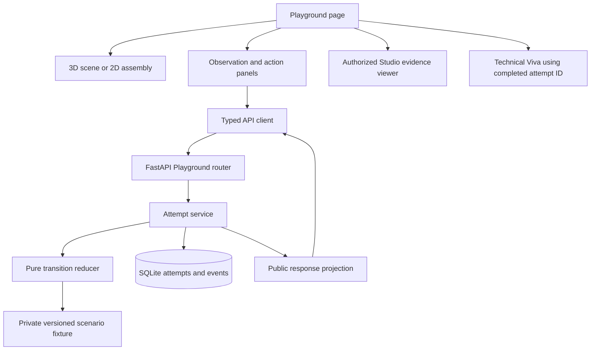

# Takumi Apprentice Playground Implementation Plan

Implementation update: a standalone React and Vite frontend now lives at the repository root. See [run instructions and implementation boundaries](../../README.md). It uses React Three Fiber, deterministic local action replay and browser persistence. The shared backend, server-private fixtures, approved expert evidence and Viva integration described below remain planned work. The frontend adds explicit alignment, seating and verification operations to make bearing assembly interactive.

Gameplay update: the frontend now implements a twelve-checkpoint assembly mission with component pick and placement, drag and drop, four simulated tools, alignment detents, three press increments, an authored bolt sequence and three handwheel checks. Successful completion requires all twelve checkpoints and earns 600 XP. See the [demo workflow and full checkpoint list](Takumi_Bearing_Assembly_Demo_Workflow.md) for the implemented interaction sequence. This replaces the earlier frontend's one-click assembly operations; the backend architecture below remains a future integration plan.

Build a browser training experience for one unpowered shaft and bearing inspection task. The learner inspects authored components, requests observations, selects a check, and decides whether to continue or escalate. Every training response comes from reviewed scenario fixtures and deterministic server rules.

This plan is for Person B within a three-person, 36-hour hackathon. It expands the [Playground component plan](../hackathon/02-apprentice-playground.md) and follows the [shared demo architecture](../hackathon/README.md). The [Playground OpenAPI contract](../hackathon/openapi/apprentice-playground.openapi.json) defines the API shapes. The original product context is in [the concept document](Takumi_Final_Concept_and_Three_Person_Technical_Plan.docx).

## 1 Scope and delivery target

Deliver two reviewed scenario variations, one simple assembly view, evidence playback, persistent attempts and a handoff to the scripted Technical Viva. Expert Studio remains the only live agentic component. Playground performs no model inference, scenario generation, free-form tutoring or automatic adaptation of live expert answers.

| Capability | Required implementation |
| --- | --- |
| Scenario selection | Two fixed cards showing title, learning objective and mode |
| Assembly view | Base, housing and shaft as selectable authored components |
| Inspection | Explicit inspection action recorded by the API |
| Observation request | Reveal only the observation allowed by the current scenario state |
| Check selection | Predefined actions with server-validated prerequisites |
| Decision | Continue or escalate with authored outcomes |
| Feedback | Fixed explanation, separate score dimensions and source references |
| Persistence | Resume an attempt after browser reload |
| Viva handoff | Pass the completed attempt ID to Person C's component |
| Fallback | Labeled 2D view using the same actions and rules |

3D is a presentation layer. The demo does not calculate friction, stress, tolerances or tactile feel. Actual observations and advice must be supplied or reviewed by the instructor. Domain text in early fixtures must be marked as provisional until that review is complete.

## 2 Learner journey and screen layout

1. Open the Playground and choose a reviewed scenario and guided or assessment mode.
2. Read the task context and see the approved demonstration release label.
3. Rotate the view or select a component. Camera changes and selection alone remain local.
4. Press an explicit inspection action to record a learning event.
5. Request the available observation and choose a check.
6. Select continue or escalate. The server returns the accepted outcome.
7. Review the decisions, feedback and evidence, then open the Technical Viva.

Use one main training screen: task and release header, assembly viewport, observation panel, available action buttons, and a compact activity history. On small screens place the viewport above the panels. Show the selected component by both label and highlight. Action buttons must work without interacting with the 3D canvas.

Disable decision buttons while a mutation is pending. Camera movement can remain responsive. Show loading, retry, stale-state and media-unavailable messages in place. A network failure must not show a successful transition. A terminal attempt displays a result panel and an explicit Viva button.

Guided mode may show authored hints and evidence during practice. Assessment mode withholds explanatory feedback, source links that reveal the solution, and scores until the attempt completes. Both modes use identical authoritative transition rules.

## 3 Application architecture



Use the shared Next.js and TypeScript frontend, FastAPI service and SQLite database. Keep server fixtures outside the frontend directory and static asset tree. Use React Three Fiber and Three.js for primitive geometry only after the equivalent 2D flow works. The proposed folders below are implementation targets; no application skeleton currently exists in this documentation repository.

```text
apps/web/
  app/playground/page.tsx
  app/playground/attempts/[attemptId]/page.tsx
  components/playground/
    AssemblyScene.tsx
    AssemblyFallback.tsx
    ActionPanel.tsx
    ObservationPanel.tsx
    AttemptSummary.tsx
    EvidenceViewer.tsx
  lib/playground-api.ts
  types/playground.ts
apps/api/
  playground/router.py
  playground/schemas.py
  playground/models.py
  playground/service.py
  playground/engine.py
  playground/projection.py
  playground/fixture_loader.py
  fixtures/demo_bundle_v1/
    manifest.json
    scenarios/proceed.json
    scenarios/escalate.json
  tests/playground/
```

Person B also supplies the shared session middleware, migration runner, database connection and idempotency helper. Keep these reusable by Studio and Viva without moving their component logic into Playground.

## 4 Authored content and release binding

Freeze `demo_bundle_v1` with two scenario versions. Each scenario points to an immutable approved knowledge release and valid evidence IDs. Public component IDs are `base`, `housing` and `shaft`.

| Variation | Learning objective | Successful path |
| --- | --- | --- |
| Proceed after evidence | Gather the required observations before choosing the reviewed next action | Inspect, request observation, select check, continue |
| Escalate under uncertainty | Recognize when the available evidence does not justify proceeding | Inspect, request observation, select check, escalate |

The expert must approve the exact observation text, available check, rationale and outcomes for both variations. The labels above describe the software flow, not a validated mechanical procedure.

Separate public scenario metadata from private rules. Public metadata includes ID, version, title, scene template and component IDs. Private data includes observations, transition tables, prerequisites, hints, scoring and evidence mappings. Return only the current public projection to the learner.

At startup validate that all referenced states, actions, components, evidence, release IDs and terminal outcomes exist; every reachable nonterminal state has a way forward; and the linked Viva bank exists. Refuse to activate an invalid bundle. Compute the bundle hash from canonical JSON for all bundled scenario and Viva files, excluding the hash field itself. Store immutable versions and reject attempts to replace existing content under the same version.

Studio publication does not update active scenarios. A live response can be used only after an operator checks its support, remaps evidence, reviews the dependent scenario and Viva fixtures, and activates a new bundle version. Existing attempts continue to use their original bundle. The seeded learner demo must be labeled as a frozen approved demonstration release.

## 5 Deterministic state machine

Implement the transition engine before rendering the assembly. Its input is the immutable scenario fixture, stored attempt state and action ID. Its output is the next state, revealed observations, fixed feedback, score changes and outcome. It must not depend on wall-clock time, random values, external services or browser state.

Use these stable action IDs for the initial fixture: `inspect_housing`, `request_observation`, `choose_check`, `continue`, and `escalate`. Action definitions bind target and observation IDs on the server. If a second candidate check is needed, give it its own ID and an explicit reviewed transition.

| State | Accepted normal action | Next state | Result |
| --- | --- | --- | --- |
| `awaiting_inspection` | `inspect_housing` | `inspected` | Record inspection |
| `inspected` | `request_observation` | `observation_available` | Reveal reviewed observation |
| `observation_available` | `choose_check` | `decision_ready` | Record the reviewed check |
| `decision_ready` in proceed variation | `continue` | `completed` | Reviewed successful outcome |
| `decision_ready` in escalation variation | `escalate` | `completed` | Reviewed successful escalation |

Author explicit alternative branches: continuing too early produces a terminal critical-error outcome; continuing in the escalation variation produces a terminal critical-error outcome; escalating unnecessarily in the proceed variation produces a reviewed, noncritical learning outcome. Any additional branch requires an explicit fixture entry. Expose early continue only if it is a deliberate assessed choice in that state. A known action that has no transition in the current state returns 409 without mutation; an unknown action ID returns 422. A completed attempt rejects all new actions.

Camera movement and component highlighting do not change attempt revision. Repeating an already completed inspection with a new request key is a known but unavailable action; it returns 409. Retrying the original successful request with its original key returns its original response.

## 6 Persistence and transaction design

| Record | Essential stored fields |
| --- | --- |
| Bundle | ID, content hash, approved release ID, activation state |
| Scenario version | Scenario ID, version, bundle ID, immutable fixture snapshot |
| Attempt | ID, learner ID, scenario version, bundle ID/hash, release ID, mode, revision, state, revealed observations, score dimensions, critical error, outcome |
| Event | ID, attempt ID, revision before/after, action ID, accepted result, actor, audit timestamp |
| Idempotency record | Actor, HTTP method and concrete route, key, canonical request hash, HTTP status, original response |

An accepted action runs in one database transaction:

1. Authenticate and verify that the learner owns the attempt.
2. Look up the idempotency record. Replay the original response for the same request hash; return 409 if the key was reused for a different payload.
3. Load the attempt and exact fixture snapshot; compare `expected_revision`.
4. Validate the action and evaluate the pure reducer.
5. Append one event, update the attempt using a revision-checked write, and increment revision exactly once.
6. Store the response and idempotency record, then commit.

Use a write transaction that serializes conflicting SQLite writes, plus a conditional revision update. A concurrent loser must receive 409 or a retried duplicate response, never a second score change. Keep provider calls and media reads outside this transaction. Persist successful mutations and their response atomically; validation failures must not advance state.

## 7 API implementation

All paths have the shared `/api/v1` prefix and require a preprovisioned learner bearer session. The server derives identity; the client cannot supply learner identity, trusted scores, completion state, release version or arbitrary next state.

| Method and path | Behavior |
| --- | --- |
| `GET /playground/scenarios` | List active public scenario summaries |
| `POST /playground/attempts` | Accept scenario ID and mode, bind active versions, return initial attempt |
| `GET /playground/attempts/{attempt_id}` | Restore the owned attempt's public state |
| `POST /playground/attempts/{attempt_id}/actions` | Accept action ID and expected revision, return authoritative attempt state |

Example action request:

```http
POST /api/v1/playground/attempts/attempt_demo_01/actions
Authorization: Bearer <demo-learner-session>
Idempotency-Key: action-demo-02
Content-Type: application/json

{"action_id":"request_observation","expected_revision":1}
```

Return the `Attempt` shape in the existing OpenAPI contract: bound IDs, revision, state, status, available actions, revealed observations, feedback, score dimensions, critical-error flag and outcome. During assessment return empty feedback and score arrays until completion; do not return concealed observations or private transition data. Error bodies use `{code, message, details}`. Use 401 for invalid sessions, 404 for unknown or inaccessible attempts, 409 for revision/state conflicts and 422 for malformed or unknown action values.

The browser creates a new idempotency key per intended mutation and retains the key and exact payload across transport retries. On a revision conflict, fetch the attempt and ask the learner to select an action against refreshed state. Do not automatically resubmit a choice against a different revision.

## 8 Frontend implementation details

Build the 2D assembly first with labeled selectable components and an explicit action panel. Load the 3D scene on the client only. Use simple meshes, a fixed initial camera, orbit controls and a single highlight color plus text labels. Keep the scene template independent of scenario rules: both variations reuse geometry and differ only in returned observations and accepted actions.

Treat API attempt data as the source of truth. Keep camera, selected component, open evidence panel and pending-request state local. Restore attempts by URL after reload. Do not calculate scores or infer a successful task from animations. Animate only accepted server transitions.

Handle WebGL initialization failure with the same 2D component view and preserve the attempt ID. Missing media displays an evidence error with retry while retaining the text feedback and attempt result. Keyboard users can select labeled components and every action without canvas interaction. Use explicit pending and error text rather than color alone.

## 9 Studio and Viva integration

Person A supplies approved evidence records and authorized media access. Resolve evidence through `GET /studio/evidence/{evidence_id}`; display attributed expert-response text or stream the authorized video and seek to the stored interval. The viewer should stop or clearly mark the end of the referenced segment. Use authenticated media fetching or the agreed authenticated player path; a native video URL alone cannot attach a bearer header. Test browser seeking and byte-range access on the deployed build.

Person C starts Viva with `POST /viva/sessions` using the completed Playground attempt ID. The server reads the bound scenario, release, outcome and bundle from persistence. The client never submits a score or selects its own rubric. Both successful and unsuccessful completed attempts can proceed to their fixture-mapped question bank.

At hour 2 provide A and C stable IDs, example public responses and the chosen session mechanism. At hour 10 obtain approved source references from A. At hour 16 provide C one real completed attempt and one failure attempt, with their matching question-bank mappings.

## 10 Build sequence and checkpoints

| Hours | Implementation work | Exit condition |
| --- | --- | --- |
| 0–2 | Freeze IDs, fixture schema, sessions and API examples | All three people can build against fixed shapes |
| 2–6 | Shared database bootstrap, fixture loader, reducer and attempt API | A complete action sequence works through HTTP |
| 6–10 | 2D assembly, action controls, observations and resume | A learner completes one persisted scenario in the browser |
| 10–16 | Second variation, evidence viewer and Viva handoff | Both branches use real approved evidence and launch Viva |
| 16–22 | Primitive 3D, wrong choices, conflict and retry behavior | Same server behavior in 2D and 3D |
| 22–26 | Replay, privacy and concurrency verification | Acceptance checks below pass |
| 26–30 | Deploy persistent API/UI and verify media | Full flow works on the judging device |
| 30–36 | Freeze content, fix defects and rehearse | Three clean reset and replay runs |

If shared backend work slips, defer 3D and retain the complete 2D flow. For a 24-hour event, use one reviewed scenario, keep the same API and persistence rules, finish implementation by hour 18, and reserve six hours for deployment and rehearsal.

## 11 Verification and acceptance criteria

Use focused reducer and API tests for the rules that determine training results. Check browser integration manually with the deployed build.

| Check | Required result |
| --- | --- |
| Deterministic replay | Identical fixture and action sequence yield identical states, observations, feedback and scores, excluding IDs and timestamps |
| Both reviewed variations | Proceed and escalation paths reach their authored outcomes |
| Critical wrong choice | Early continue or unsupported continue retains its critical-error flag |
| Invalid transition | Unknown action returns 422; unavailable action returns 409; neither changes revision |
| Duplicate request | Same key/payload returns the original result with one event and one score change |
| Changed duplicate payload | Same key with a changed request returns 409 |
| Concurrent actions | At most one distinct action commits for the same expected revision |
| Ownership | Another learner cannot read or mutate the attempt |
| Assessment privacy | Responses and frontend assets expose no concealed rubric, observation or explanation |
| Resume | Reload restores the same bound scenario version and accepted state |
| Bundle update | Old attempts retain original content after a new bundle activation |
| 2D fallback | Same attempt can continue with equivalent actions after renderer failure |
| Evidence and Viva | Source links resolve and the completed attempt starts its mapped interview |

Keep decision accuracy, evidence gathering and recognition of limits separate. The fixture assigns fixed integer earned/available points; each scoring event awards at most once. Viva explanation points cannot erase a Playground critical error. Report exercise outcomes without claiming practical certification.

## 12 Demo operations and definition of done

Seed the approved bundle, source media and demo learner session before rehearsal. Use a persistent single-host database and media directory. Do not use temporary deployment storage for attempts or evidence. Log attempt ID, fixture hash, action ID, revision and result; avoid logging session tokens.

Coordinate with Person C's operator reset command. Reset removes demo learner attempts and their dependent events, Viva records and idempotency records while preserving approved releases, fixtures and media. The command must refuse a non-demo database. Keep reset outside the public API.

The Playground is complete when a learner can start either reviewed variation, inspect and request information, receive a server-authoritative result, open the supporting evidence, resume after reload and launch Viva. Repeated requests must not double score, assessment mode must conceal the solution, and the same sequence must replay consistently after a clean reset.
