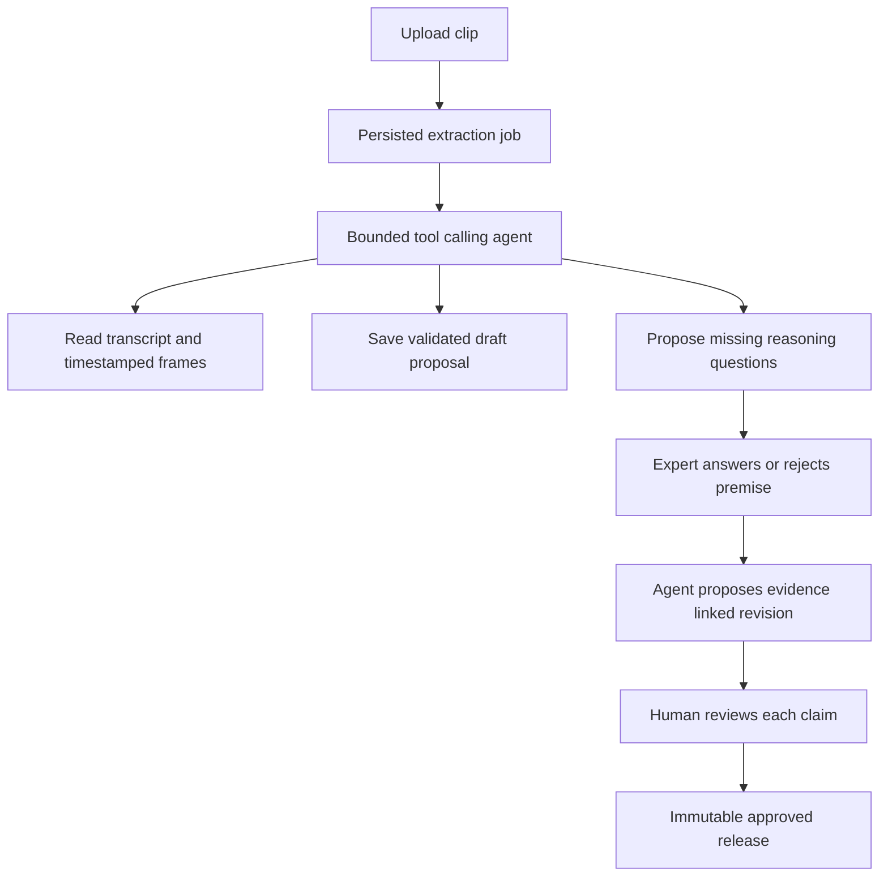

# Part 1 Expert Studio

Owner: Person A. Contract: [Studio OpenAPI](openapi/expert-studio.openapi.json).

## Scope and architecture

This is the only real agentic implementation. An expert uploads a two to four minute clip, the worker extracts source-linked draft units, identifies reasoning gaps, asks up to three useful questions, incorporates actual answers, and proposes revisions. The expert corrects and approves the result. Nothing publishes through an agent tool.

Use a hosted video adapter or timestamped frames plus narration. At hour 2 choose the path that actually works with the available account. The adapter returns structured units, evidence spans and gap proposals. No embeddings or general retrieval are required: the complete small task pack fits the Studio context. User media and answers are data; their contents cannot grant tool authority.

Agent tools are `read_task_sources`, `read_draft`, `propose_units`, `propose_questions` and `propose_revision`. Schemas reject unknown evidence IDs and references outside the task. Tools write proposals only. The orchestrator enforces a maximum of eight tool calls per run, three clarification questions total, a 90 second provider timeout per call, two transient retries, and a six minute job deadline. Persist tool inputs, sanitized outputs, stage and prompt/model version. Surface actual stages rather than invented progress percentages. A model choosing and invoking tools against task state, followed by validation and expert input, is the demonstrable agent loop.

## Data and state

Tables: tasks, media, jobs, drafts, knowledge_units, evidence, clarification_questions, expert_answers, releases, audit_events and idempotency_records. Person A owns these migrations; coordinate shared base/session tables with B.

Job states: `queued -> running -> awaiting_expert -> completed`, with `failed` reachable from active stages. Extraction saves a draft and questions before awaiting expert input. Each submitted answer queues a follow-up run against the current draft revision; serialize draft jobs to avoid concurrent overwrites. The job becomes completed when the response is incorporated or all pending questions are resolved. Rejected premises and deferred answers remain explicit unknowns. Publication is a separate operation from job completion.

Knowledge units contain action, cue, interpretation, decision, exception and field-level evidence IDs. Missing fields remain null. Expert answers have separate attributed evidence records and never masquerade as video quotes. Preserve corrections and prior draft revisions. Draft statuses are `editing`, `review`, `published`; publish requires all included claims to be reviewed as supported, resolved questions or explicit unknowns, and no active draft job. Publication returns an immutable snapshot. Published drafts reject edits; for this minimal demo a new capture starts a new draft. A dedicated fork endpoint is deferred.

## API workflow

1. `POST /studio/tasks` creates the equipment context.
2. `POST /studio/tasks/{task_id}/media` uploads multipart media and returns a queued job. Enforce 100 MB, four minutes, real decodability and checksum server-side; handle duplicate requests without duplicate jobs.
3. `GET /studio/jobs/{job_id}` polls stored stages and draft ID.
4. `GET /studio/drafts/{draft_id}` returns units, evidence, questions and revision.
5. `POST /studio/drafts/{draft_id}/answers` stores an attributed answer and queues the agent revision. `question_id` must belong to this draft; `disposition` may be answered, rejected or deferred.
6. `PATCH /studio/drafts/{draft_id}` replaces editable units using the expected revision. Reviewed flags require reviewer authority. Unknown fields or IDs fail validation.
7. `POST /studio/drafts/{draft_id}/publish` performs validation and publishes transactionally. A new release does not change learner fixture bindings.
8. `GET /studio/evidence/{evidence_id}` resolves approved learner evidence or authorized draft evidence. `GET /studio/media/{media_id}` streams authorized media with range support.

The OpenAPI file supplies exact request and response shapes. Polling is sufficient; omit streaming chat and websockets.

## Implementation order

First build media storage and a single real extraction spike. Next persist the adapter result and expose draft review. Then implement the bounded tool loop, questions and actual expert response ingestion. Finally implement field-level review, publication and learner evidence resolution. A 3D dependency must never block Studio completion.

If extraction fails, retain the clip and prior stage, show the error and allow another upload. Resume valid stored stages on worker restart using a transactional lease and bounded retry count. Never overwrite human edits with a late agent proposal: compare the base revision and require review on conflict. During a venue outage, the operator can select a visibly recorded prior run; publication in replay mode must not be advertised as a fresh model run.

## Acceptance and handoff

Demonstrate a question grounded in a genuine missing reason; answer it with the instructor; show its new evidence ID and the changed draft; reject an unsupported specification; approve a release; open its original evidence. Verify invalid spans, cross-task IDs, stale edits, unauthorized publication, repeated upload/answer/publish requests and restart recovery. Record actual model latency and question/review time.

Deliver B and C one seeded approved release, evidence records, source media, and a stable evidence-viewer contract by hour 10. Live outputs can vary; learner fixtures stay frozen until separately reviewed and versioned.
