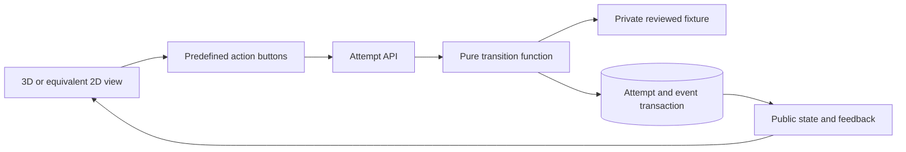

# Part 2 Apprentice Playground

Owner: Person B. Contract: [Playground OpenAPI](openapi/apprentice-playground.openapi.json).

## Scope and architecture

Build an authored shaft and bearing scene with component selection, observation requests, predefined checks, continue/escalate choices and source-backed feedback. All scenarios, observations, transitions and outcomes are hardcoded reviewed fixtures. There are no model calls, generated geometry, simulated engineering physics or free-form agent actions.

Use authored primitive geometry for base, housing and shaft. Camera movement and highlights are local UI state; accepted training decisions wait for the server. If the renderer fails, the same API drives a labeled 2D view. B owns both this UI and the shared backend foundation; keep the scene simple enough for this workload.

## Fixture design

`demo_bundle_v1` has a guided variation and a changed-condition variation. The first supports a reviewed proceed branch after the required evidence; the second requires escalation because the provided observations are insufficient or inconsistent. An instructor supplies the actual observations and allowed checks. No numeric tolerance is invented.

Public fixture: scenario ID, version, release ID, title, scene template, component IDs and current available action definitions. Private fixture: initial state, action transition table, prerequisites, observations, terminal outcome, per-dimension scores and feedback evidence. Never bundle private fixtures into frontend assets or return hidden answers through the API.

Example states: `awaiting_inspection -> inspected -> observation_available -> decision_ready -> completed`. Early continue reaches a reviewed terminal error branch; an invalid action ID returns 422 without mutation. A known but unavailable action returns 409. For the escalation variation, requesting the required observation then escalating is the successful terminal path. Terminal attempts reject further actions and expose a Viva launch control.

The pure reducer accepts `(fixture_version, state, action_id)` and returns accepted state, feedback and score changes. It never reads system time or random state. Scenario actions use stable IDs such as `inspect_housing`, `request_observation`, `choose_check`, `continue`, `escalate`. Each action definition binds target and observation internally, so the browser cannot substitute an arbitrary measurement.

## Data and API workflow

Tables: bundles, scenario_versions, playground_attempts and playground_events. Each attempt stores learner identity, scenario version, bundle hash, immutable release ID, revision, current state, accumulated decisions and terminal result.

1. `GET /playground/scenarios` lists only active public scenario summaries.
2. `POST /playground/attempts` accepts `scenario_id` and guided/assessment mode; resolves exact versions server-side and returns initial public state.
3. `GET /playground/attempts/{attempt_id}` restores public state after reload.
4. `POST /playground/attempts/{attempt_id}/actions` accepts only `action_id` and `expected_revision`, plus the shared idempotency header.

One transaction checks ownership, deduplication, revision and allowed transition, then appends the event, stores result and increments revision. Inspect events that affect prerequisites pass through this endpoint; free camera motion does not. Response includes available actions and only observations already revealed. Assessment feedback withholds answers until completion; guided mode may show authored hints. Neither mode exposes private rules.

Viva reads completed attempt state from the database; the client sends only its attempt ID. A new bundle activation affects new attempts only. The deployment seeds approved bundles; no runtime scenario authoring or publication UI is necessary.

## Implementation order

At hours 0–2 create the shared FastAPI shell, SQLite migration runner, session-role middleware, idempotency helper and response fixtures. Provide typed contracts to A and C immediately. Build and test the pure reducer before the scene. Implement attempts and transactions, then the labeled 2D flow. Add primitive 3D only after both reviewed paths work. Finally bind evidence playback through Studio and deploy the single API, frontend and worker on persistent storage.

## Acceptance and handoff

Replay an identical action sequence in fresh attempts and compare public states, observations and dimension scores excluding IDs/timestamps. Cover both successful variations, early wrong decision, missing prerequisite, unknown action, stale revision, duplicate action, key reuse with another payload, terminal action and another learner's attempt. Assert one stored event and one score change for duplicate submissions. Ensure public JSON and frontend assets contain no hidden rubrics.

At hour 16 provide C a completed attempt fixture and a real completed attempt. Keep scoring dimensions separate: decision accuracy, evidence gathering and recognition of limits. Viva explanation quality cannot cancel a critical wrong decision. If deployment time is short, retain the 2D view and cut animation.
