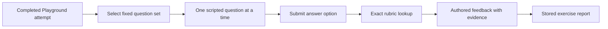

# Part 3 Technical Viva

Owner: Person C. Contract: [Viva OpenAPI](openapi/technical-viva.openapi.json).

## Scope and architecture

Create a virtual technical interview using three scripted questions: explain the chosen check, respond to a changed condition, and identify insufficient evidence. Questions, branches, accepted answers, feedback and evidence links are authored and reviewed. No interview agent, question generation, speech service or model grading runs in this component.

Default to answer choices so grading is deterministic and defensible. An optional typed explanation is stored as an ungraded reflection and clearly labeled that way. Do not use keyword matching to imply reliable free-text assessment. A static interviewer portrait and authored chat bubbles provide the interview presentation; an avatar animation is optional polish.

## Fixture and state design

Each scenario version maps to an ordered three-question bank with stable question IDs, prompt, options, rubric version and private per-option assessment. Every option maps to exact feedback text, explanation points, recognition-of-limits result and evidence IDs. Do not shuffle questions or options. Tailoring is a fixed lookup by scenario version and terminal outcome, never a model inference.

A session stores its source attempt, learner, bundle hash, release, selected bank, revision, current question index and answers. States are `in_progress` and `completed`; the third accepted answer automatically completes the interview and freezes the result. One active session per source attempt is enough; repeated starts return it, and completed starts return the completed session. A new practice attempt is the way to retry.

Only the current question and its options are public while in progress. Store option grades and future answer keys server-side. Feedback is returned after each accepted answer; future questions follow in the session response. On the final answer return a completed session and result ID. Repeated submissions return the original stored response through idempotency.

## API workflow

1. `POST /viva/sessions` accepts a completed Playground attempt ID. Reject incomplete attempts, another learner's attempt, missing question bank or release mismatch. Bind the exact bundle used by that attempt.
2. `GET /viva/sessions/{session_id}` restores progress and returns the current question or completed status.
3. `POST /viva/sessions/{session_id}/answers` accepts `question_id`, `option_id`, optional `reflection` and `expected_revision`. Validate that question and option belong to the current bank and position.
4. `GET /viva/sessions/{session_id}/result` returns 409 until complete, then returns each answer, fixed feedback, evidence references and independent dimension scores.

Scores are points earned and available per dimension, not a probability of readiness. The final report shows Playground decisions and observations separately from Viva explanation points. A critical Playground error remains visible regardless of Viva score. The result states that supervised practical assessment is still needed. Evidence opens the Studio resolver using the same immutable release context.

## Implementation order

First implement a static interview screen and response fixtures, then exact option-to-feedback lookup and persisted progress. Integrate the completed-attempt handoff with B and evidence rendering with A. Add result summary and reload behavior. Finish with the operator reset command and demo script. C owns a local operator CLI that, in one transaction, removes only demo learner attempts, events, Viva sessions, answers and idempotency records tied to them; it preserves Studio media, approved releases and frozen bundles. The command must refuse non-demo database configuration. Do not add a public reset endpoint.

## Acceptance and handoff

Every question option must have a fixture-defined result; execute the option matrix and compare exact feedback/evidence/points. Reject out-of-order questions, options from another question, stale revisions, another learner's session and early result requests. Confirm duplicate final answers do not create two results. Resume after browser reload; finish all three questions; open each source; run the clean reset and repeat the same sequence.

Use typed choices as the fallback if chat presentation or animation slips. For 24 hours keep one three-question bank and the plain interview UI. The demo must label the interview as scripted and must not claim automatic assessment of arbitrary spoken reasoning.
