# Part 3 Technical Viva

Owner: Person C. Detailed design: [Technical Viva implementation specification](../globals/03-technical-viva-implementation-spec.md). The live interview design supersedes the original choice-based Viva. Existing generated contracts must be checked against the application OpenAPI before relying on them as a client contract.

## Experience and architecture

A completed Playground attempt launches an animated AI examiner. The learner answers three reviewed core objectives by voice or text: explain the chosen check, respond to a changed condition, and recognize insufficient evidence. The interviewer can ask one follow-up per objective. In examiner mode, neutral acknowledgments and clarification happen during the interview; grading and corrections appear in the final report.

```mermaid
flowchart LR
  Attempt[Completed owned attempt] --> Session[Release-bound interview]
  Session --> Persona[Animated persona and voice/text UI]
  Persona --> Control[Server-owned question progression]
  Control --> Turns[Persisted completed turns]
  Turns --> Job[Frozen evaluation job]
  Job --> Check[Rubric and citation validation]
  Check --> Report[Report and complete source index]
```

Use Next.js/React/TypeScript, a simple SVG persona, FastAPI/Pydantic/SQLAlchemy, SQLite, a persisted evaluation queue, OpenAI Realtime for speech, and a separate structured evaluation request. The demo runs one API, one worker, and one database. See the root [run guide](../../README.md) for startup and provider configuration.

Fixture provider mode is an explicit offline simulation for development and tests. It must remain visibly labeled. It does not demonstrate a live voice service or validate arbitrary reasoning. Live provider calls require configured credentials and verified model access.

## Session and evidence boundaries

Bind the source attempt's learner, release ID, bundle hash, question plan, rubric, and prompt/model configuration. Repeated starts return the existing session. A fresh Playground attempt is the retry mechanism. Only the current question is exposed during the interview; private scoring descriptors and future answer keys stay server-side.

Persist completed turns and ordered session events; partial captions do not count as accepted answers. Deduplicate provider events and client mutations, check revisions, serialize progression, and freeze the transcript before evaluation. Reconnect restores the stored state and replaces the old voice epoch. Text fallback uses the same question and report pipeline.

The report preserves Playground scores and critical errors independently of interview performance. Every source reference must resolve within the bound release. Its source index includes all manifest documents, with cited/unused/unavailable status; a document appearing in the index does not imply it was assessed.

## API workflow

All application routes use `/api/v1` and authenticated ownership checks.

1. Start or restore a release-bound session from a completed attempt.
2. Negotiate voice through the backend or answer the current question in text.
3. Poll durable events; use repeat, pause/resume, and finish controls as needed.
4. Finish once, freeze the transcript, and queue a unique evaluation job.
5. Poll evaluation status and retrieve the completed evidence-linked report.
6. Resolve source documents through release-scoped authorized Studio endpoints.

The detailed specification defines paths, inputs, statuses, failure recovery, and contract types. The running API publishes its actual contract at `/openapi.json` and interactive documentation at `/docs`.

## Delivery sequence

Write acceptance tests first. Build session persistence and a complete typed interview, then evaluation/reporting, then voice/sideband, avatar playback, and reconnect behavior. Integrate the real Playground handoff and approved Studio manifest early. Keep a seeded release and completed attempts for isolated development, clearly distinguished from live upstream execution.

| Hours | Deliverable |
| --- | --- |
| 0–2 | Provider compatibility spike, reviewed objectives, source manifest, rubric/interface agreement |
| 2–8 | Session/events, text interview, persona and controls |
| 8–16 | Voice transport, server control, bounded follow-ups and persisted transcript |
| 16–22 | Evaluation job, validated rubric scores and citations |
| 22–28 | Report, print layout, full document index and integration |
| 28–32 | Ownership, duplicates, interruption, recovery and failure checks |
| 32–36 | Deployment, measured timings, guarded reset and rehearsals |

## Acceptance

Complete all objectives in voice and text, observe a bounded follow-up, reload/resume without duplicating answers, and inspect a validated report with supporting learner turns and approved evidence. Test another learner's access, wrong/out-of-order questions, stale revisions, repeated mutations/finish requests, invalid evidence, unavailable providers, and early incomplete completion.

Run the guarded operator reset only on an explicitly marked demo database. Preserve approved knowledge and media. Rehearse three deployed runs and record actual response latency, evaluation duration, and provider usage. AI-assisted assessment does not replace supervised practical assessment.
