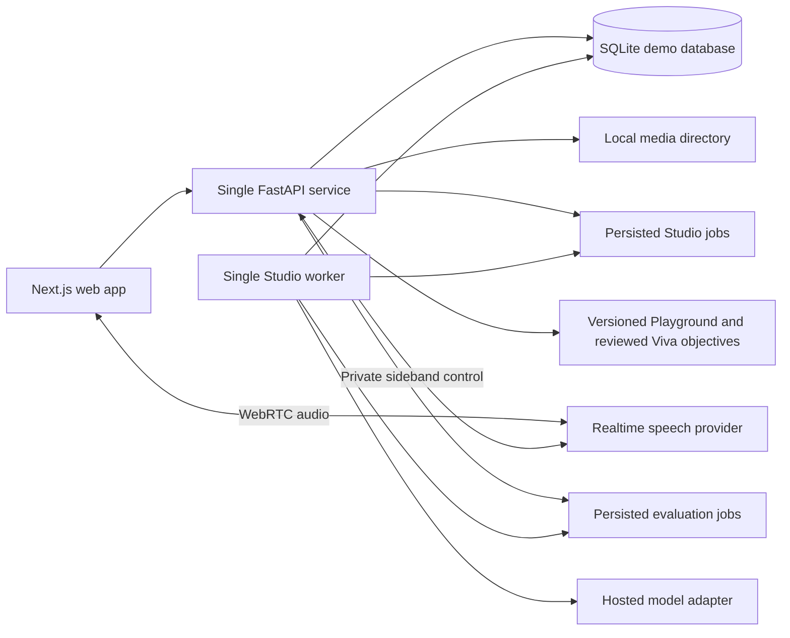

# Takumi hackathon implementation

Build three experiences for one unpowered shaft and bearing inspection task. Expert Studio extracts and reviews knowledge; Apprentice Playground uses authored deterministic scenarios; Technical Viva provides a live AI examiner with voice/text answers and a source-backed evaluation. The [Viva implementation specification](../globals/03-technical-viva-implementation-spec.md) defines the revised interview architecture.

Source: `../globals/Takumi_Final_Concept_and_Three_Person_Technical_Plan.docx`. Planning assumption: three people, 36 hours. The repository now includes the Viva application; consult the root [run guide](../../README.md) for implemented behavior, fixture mode, checks, and deployment limitations.

| Person | Component | Deliverables |
| --- | --- | --- |
| A | [Expert Studio](01-expert-studio.md) | Upload, real extraction and clarification agent, evidence review, immutable publication |
| B | [Apprentice Playground](02-apprentice-playground.md) | Shared API foundation, authored scene, deterministic scenarios, attempts and release binding |
| C | [Technical Viva](03-technical-viva.md) | Animated interviewer, live voice/text, bounded follow-ups, validated report and demo reset |

The `openapi/` directory contains proposed component contracts generated by `build_openapi.py`. The application publishes its actual API contract at `/openapi.json`; compare generated contracts with it before client integration. Do not assume the original scripted Viva contract matches the revised live interview.

## Architecture

Use a single API and database, not three microservices. SQLite and local media on a persistent single host are the default hackathon topology. Person B owns database bootstrap, session middleware and deployment; each person owns their component tables and routers. Run one worker process that claims persisted jobs transactionally. Use live speech for Viva with text fallback. Redis, pgvector, a graph database, automatic scenario generation, and general learner chat are outside the hackathon core. Pin dependencies after a compatibility smoke check. Production tenancy, distributed workers and cloud media storage are later work.

## Meaning of deterministic

Playground state, revealed observations, scores, and feedback depend only on the versioned fixture and submitted action IDs. No random scenario selection, model calls, generated text, or timing-dependent scores are allowed in Playground. IDs and audit timestamps may differ between runs. Viva keeps reviewed core objectives and bounded server progression, but live replies, follow-ups, and model assessment are variable. Do not claim deterministic Viva grades.

Studio orchestration is bounded and repeatable; its model output is inherently variable. Use a fixed input clip, persisted stage outputs, frozen prompts and an available model, structured validation, a maximum of three questions, and explicit human approval. Do not describe live model responses as mathematically deterministic. Rehearsal mode replays a named prior run and visibly displays `Recorded Studio run`; it must never appear to be a live execution.

## Content boundary and integration

Freeze `demo_bundle_v1` containing two reviewed scenarios and three reviewed Viva objectives/base prompts per scenario, plus task-specific rubrics and an approved document manifest. Every fixture references an exact approved knowledge release, evidence IDs and stable component IDs (`base`, `housing`, `shaft`). A stored bundle hash identifies all public and private fixture files. Learner attempts retain that bundle and release forever.

The live Studio publication does not automatically activate this bundle. On a fresh demo, learner screens use the seeded, explicitly labeled approved demonstration release. If the team wants the live expert answer to appear in the learner flow, an operator must verify that its meaning supports the authored scenario, manually map its evidence ID, review the whole bundle, and activate a new bundle version before starting an attempt. No automatic rewriting or activation. Unsupported live answers remain Studio-only. This trades automatic end-to-end generation for a reliable demo without inventing provenance.

Shared evidence records contain `id`, `task_id`, `type` (`video` or `expert_response`), `author`, and either `media_id/start_ms/end_ms` or attributed `text`. A release contains immutable knowledge/evidence snapshots and a document manifest with identity, title, version, checksum, authorized resolver, and evidence membership. Evidence links resolve through Studio's evidence endpoint, then seek the media or display the attributed response. Validate `0 <= start_ms < end_ms <= duration_ms`.

## Common API rules

All routes use `/api/v1`. Demo sessions are preprovisioned opaque bearer tokens with `expert`, `reviewer`, `learner` or `operator` roles; there is no login build. Never expose provider keys in the browser. The API derives actor identity from the token. Expert/reviewer can be the same authorized instructor for this demo. Check attempt ownership and task scope server-side.

JSON errors use `{code, message, details}`. Use 401 for absent/invalid sessions, 403 for forbidden scope or role, 404 for unknown or inaccessible IDs, 409 for stale revision/invalid state or changed idempotent payload, 413 for upload size and 422 for malformed values. Mutation requests carry `Idempotency-Key`; store actor, route, key, request hash and original response atomically with the mutation. Same key and same payload returns that response, even if its expected revision is now old. Same key with different payload returns 409. Check deduplication before revision checks. Revision-changing operations require `expected_revision` and increment exactly once. There is no client-supplied score or next state.

## Integration sequence

| Hours | A Studio | B Playground and foundation | C Viva and demo |
| --- | --- | --- | --- |
| 0–2 | Test one real clip and model access | Freeze contracts, seed IDs, session middleware | Verify voice/tool/evaluation compatibility and freeze objectives |
| 2–6 | Upload and persisted extraction | Database, fixture loader, attempt API | Persona UI, session/events and typed interview |
| 6–10 | Gap detection and expert answers | Scene and deterministic transition engine | Bounded question controller and voice transport |
| 10–16 | Evidence review and publication | Wire scene to real state, evidence viewer | Persist speech turns and integrate attempt handoff |
| 16–22 | Bounded tool loop and failure recovery | Wrong branch, duplicate and stale action handling | Validated evaluation, restart and reset tooling |
| 22–26 | Grounding and provenance checks | Bundle validation and integration checks | Report/source index and end-to-end Viva checks |
| 26–30 | Deployed provider and media checks | Deploy API, worker and UI | Rehearse on deployed build |
| 30–36 | Freeze prompts and content | Freeze schema and fixtures | Three reset and replay rehearsals |

For 24 hours: keep one scenario, three core objectives, simple persona, voice/text interview, a 2D component view, one Studio extraction path, and reserve the final six hours for integration. Cut 3D polish first. Preserve real clarification, evidence and approval.

## Four minute demonstration

Show the task and genuine missing explanation (30 seconds); show a processed clip and execute live clarification (50 seconds); review and publish the response (25 seconds); switch to the labeled frozen learner demo and complete a reviewed branch (60 seconds); show live Viva question/answer and bounded follow-up, then a completed report and evidence (40 seconds); state which pieces are live and which are authored, then show measured timings (35 seconds). If an approved remapped bundle is available, state its version explicitly.

Acceptance: a real expert answer changes an approved Studio release; both scenario branches replay consistently; Viva remains within its reviewed objectives and produces a validated, evidence-linked report; evidence resolves; unknown IDs, stale revisions, duplicate submissions and role violations are handled; reset leaves a clean run. Browser and Viva results demonstrate reasoning exercises, not practical certification. Domain observations and rubrics must be instructor-reviewed; this plan does not invent mechanical tolerances.
